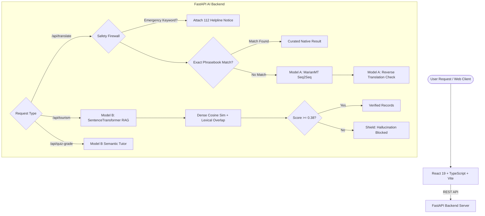

## **Khasi Companion AI** 
A dual-model, bilingual AI assistant built specifically for the **Khasi language** (spoken primarily in Meghalaya, Northeast India) and English. 

Traditional machine translation engines frequently struggle with low-resource indigenous languages like Khasi. Khasi Companion solves this with a **dual-model neural & hybrid semantic architecture** combined with a **zero-hallucination verification pipeline**, emergency safety checks, and an interactive learning hub.

---

## ⚡ Core Features

### 1. 🌐 Neural Bidirectional Translation (Model A)
- **Engine**: Fine-tuned `MarianMT` (`opus-mt-en-mul`) Seq2Seq model.
- **Direction**: Seamless **English ↔ Khasi** (`>>kha<<` and `>>eng<<`).
- **Sentence-Batching**: Automatically splits long paragraphs into distinct sentences for high grammatical fidelity.
- **Reverse Check Verification**: Performs automatic back-translation on the generated output so users can instantly assess semantic consistency.
- **Curated Fast-Path**: Instant exact-match lookup from verified native phrasebook records.

### 2. 🛡️ Zero-Hallucination Tourism RAG (Model B)
- **Engine**: Cross-lingual `SentenceTransformer` semantic embedding model.
- **Hybrid Search**: Blends **75% Dense Vector Cosine Similarity** + **25% Lexical Keyword Overlap**.
- **0.38 Strict Confidence Threshold**: Automatically blocks hallucinated responses for unverified tourist queries. It never fabricates entry tickets, timings, or cultural advice.
- **Curated Knowledge Base**: Verified guides for iconic Meghalaya destinations (Living Root Bridges, Mawlynnong, Nohkalikai Falls, Dawki River, etc.).

### 3. 🎓 Interactive Khasi Learning Suite
- **Alphabet & Phonetics**: Audio-guided visual grid for Khasi consonants, vowels, and diacritics.
- **Flashcards & Spaced Repetition**: Categorized by greetings, everyday verbs, cuisine, and nature.
- **AI Tutor & Semantic Quiz Grading**: Submit your Khasi attempt for any English prompt; Model B semantically grades your answer (0–100%) and provides grammar & dialect feedback.
- **Cultural Rhymes & Folklore**: Preserving oral folklore, nursery rhymes, and traditional stories.

### 4. 🚨 Safety & Emergency Firewall
- Automatically detects crisis or emergency keywords (`doctor`, `hospital`, `emergency`, `police`, `ambulance`, `112`, `bleeding`, `poison`).
- Instantly surfaces safety disclaimers and emergency helplines to prevent medical or life-threatening translation errors.

### 5. 💻 Responsive Modern UI
- Built with **React 19**, **TypeScript**, and **Tailwind CSS**.
- Smooth Dark / Light Mode with traditional Meghalaya silk-inspired design accents.
- Live hardware and backend diagnostics page.

---

## 🏗️ System Architecture



---

## 📂 Project Structure

```text
AI-Project khasi/
├── backend/
│   ├── data/
│   │   ├── knowledge_base.json     # Verified Meghalaya tourism database
│   │   └── phrasebook.json         # Curated native speaker phrases
│   ├── main.py                     # FastAPI server, Model A/B inference & endpoints
│   └── requirements.txt            # Python dependencies
├── backend_assests/                # Local model weights & datasets (excluded from Git)
│   ├── khasi_semantic_model_b_v1/  # SentenceTransformer MiniLM weights
│   └── khasi_translator_v1_final/  # MarianMT fine-tuned weights
├── public/                         # Public static assets & SVG icons
├── src/
│   ├── assets/                     # Imagery and theme graphics
│   ├── components/                 # Reusable UI components
│   │   ├── layout/                 # Navbar, Footer, MobileTabBar, WovenSilkDivider
│   │   ├── learn/                  # AlphabetGrid, FlashcardsView, GamesView, VocabExplorer
│   │   ├── tourism/                # TourismCard
│   │   └── ui/                     # ThemeToggle, VerificationBadge
│   ├── context/                    # ThemeContext & global React state
│   ├── data/learn/                 # Alphabet, rhymes, stories, vocabulary JSON data
│   ├── pages/                      # Page components (Home, Translate, Explore, Learn, Safety, Status)
│   ├── services/                   # Frontend API client
│   └── types/                      # TypeScript schemas
├── .gitignore                      # Git ignore configuration
├── package.json                    # Frontend dependencies & scripts
├── tailwind.config.js              # Tailwind styling configuration
└── vite.config.ts                  # Vite build configuration
```

---

## 🚀 Getting Started

### Prerequisites

- **Node.js**: v18.0.0 or higher
- **Python**: v3.9 – v3.12
- **Git**

---

### 1. Clone Repository
```bash
git clone https://github.com/<your-username>/<your-repo-name>.git
cd "AI-Project khasi"
```

---

### 2. Backend Setup (FastAPI & Models)

1. Open a terminal and navigate to `backend`:
   ```bash
   cd backend
   ```

2. Create and activate a Python virtual environment:
   ```bash
   # Windows
   python -m venv venv
   .\venv\Scripts\activate

   # Linux / macOS
   python3 -m venv venv
   source venv/bin/activate
   ```

3. Install required packages:
   ```bash
   pip install -r requirements.txt
   ```

4. *(Optional)* If using NVIDIA GPU acceleration, ensure compatible PyTorch CUDA is installed:
   ```bash
   pip install torch --index-url https://download.pytorch.org/whl/cu121
   ```

5. Launch the backend API:
   ```bash
   python main.py
   # Or using uvicorn directly:
   uvicorn main:app --reload --host 0.0.0.0 --port 8000
   ```
   The backend will be available at `http://localhost:8000` (Interactive docs: `http://localhost:8000/docs`).

> **Note on Model Weights**: Large pre-trained model folders (`khasi_translator_v1_final` and `khasi_semantic_model_b_v1`) are excluded from Git to comply with repository file size limits. Place them in `backend_assests/` or the project root. If weights are not found, the backend gracefully falls back to curated phrasebook and keyword search.

---

### 3. Frontend Setup (React + Vite)

1. In a new terminal from the project root:
   ```bash
   npm install
   ```

2. Start the development server:
   ```bash
   npm run dev
   ```

3. Open your browser and navigate to:
   ```text
   http://localhost:5173
   ```

---

## 📡 API Endpoints Reference

| Method | Endpoint | Description |
| :--- | :--- | :--- |
| `GET` | `/api/health` | Hardware detection (CPU/CUDA) and model loading diagnostics |
| `POST` | `/api/translate` | Bidirectional translation (MarianMT + reverse-check + safety detection) |
| `GET` | `/api/tourism?q={query}` | Hybrid Semantic RAG tourism search with 0.38 hallucination gate |
| `GET` | `/api/phrasebook?category={cat}` | Filtered curated native phrasebook list |
| `POST` | `/api/quiz-grade` | Evaluates learner Khasi translations using Model B semantic scoring |

---

## 📦 Scripts

- `npm run dev`: Starts Vite local development server.
- `npm run build`: Compiles TypeScript and builds production bundles to `/dist`.
- `npm run lint`: Runs Oxlint for fast code analysis.
- `npm run preview`: Locally previews the production build.

---

## 🛡️ License & Acknowledgements

- Built for cultural and linguistic preservation of the **Khasi language** (*Ka Ktien Khasi*).
- Respects community traditions and Meghalaya regional heritage.
